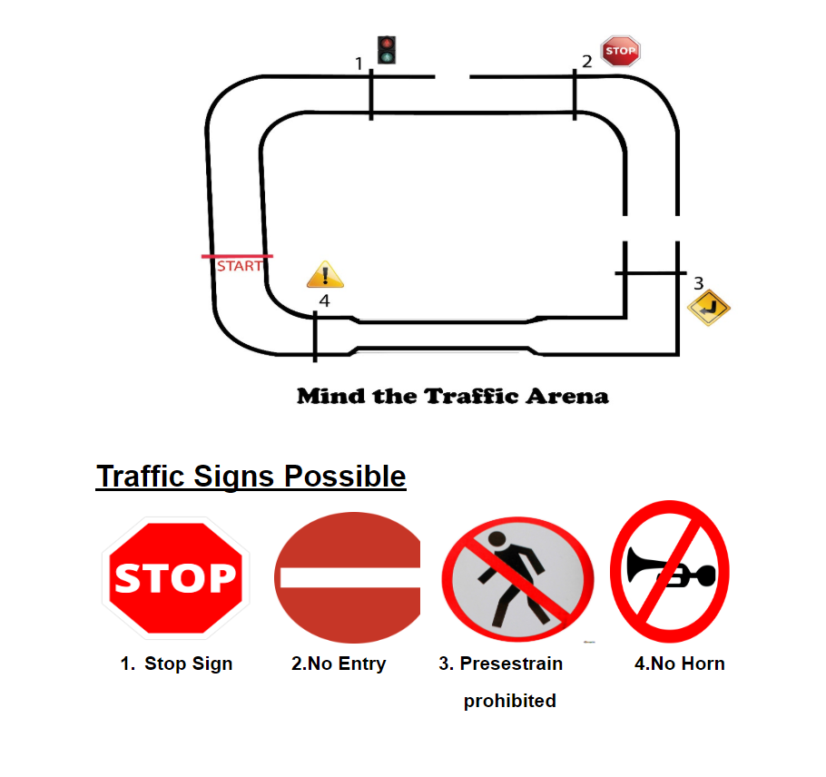

# Camera-Based Self-Driving Car

A miniature physical robot that uses camera images, OpenCV, and a convolutional neural network (CNN) to classify steering directions and follow a track. This undergraduate project connects data collection and model training to perception and motor control on real hardware.

**Raspberry Pi 3 · Pi Camera · Arduino UNO · Python · OpenCV · Keras**

## Robot photos

  
  

The robot on the track and a close-up of the hardware build. Both photos show the physical platform used in the project.

## Project overview

The goal was to learn steering decisions from labeled camera images and use those predictions to drive a small robot around a marked track. The original steering dataset contained 2,000 images for each of five classes: **straight, left, right, sharp left, and sharp right**.

The robot also supported manual control, allowing it to be driven around the track while collecting labeled images.

## How it works

1. **Capture:** acquire frames from the camera on the robot.
2. **Preprocess:** use OpenCV image processing, including color selection and resizing, to prepare the input.
3. **Predict:** use the trained CNN to classify the steering direction.
4. **Act:** send the corresponding command over serial to the Arduino, which controls the drive motors.

## Hardware and software

| Component | Role |
| --- | --- |
| Raspberry Pi 3 | Onboard image processing and steering inference |
| Pi Camera | Camera input for the driving task |
| Arduino UNO | Motor control through serial commands |
| Wheeled robot chassis and motor driver | Physical platform for driving the track |
| Python, OpenCV, and NumPy | Image capture, preprocessing, and array operations |
| Keras | CNN training and inference |
| PySerial | Communication between the Python pipeline and Arduino |

## Arena

  

The arena layout supplied with the project. The diagram includes track features and traffic-sign locations; the steering pipeline documented above maps predictions to driving commands.

## Explore the code

| File or folder | Contents |
| --- | --- |
| [Data collection](<SELF_DRIVING _CAR/Images with signs_Data Collection.py>) | Keyboard-controlled image collection and steering labels |
| [CNN training](<SELF_DRIVING _CAR/Deep Learning Model For Training.py>) | Keras training script |
| [Driving pipeline](<SELF_DRIVING _CAR/Final Trained Pipeline.py>) | Camera preprocessing, model inference, and serial commands |
| [Saved model architecture](<SELF_DRIVING _CAR/model.json>) and [weights](<SELF_DRIVING _CAR/model.h5>) | Model files used by the driving pipeline |
| [Arduino motor control](<Arduino code.ino>) | Serial-command motor-control sketch |
| [Sample data](SampleData/) | Example images from the project |

The repository preserves scripts from different project iterations. The saved driving model uses 32 × 32 images and five steering outputs; the separate training script contains a 64 × 48, eight-class experiment.

## License

This project is available under the [MIT License](LICENSE).
